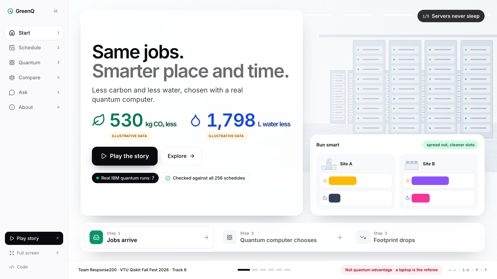
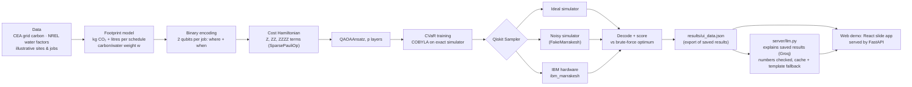
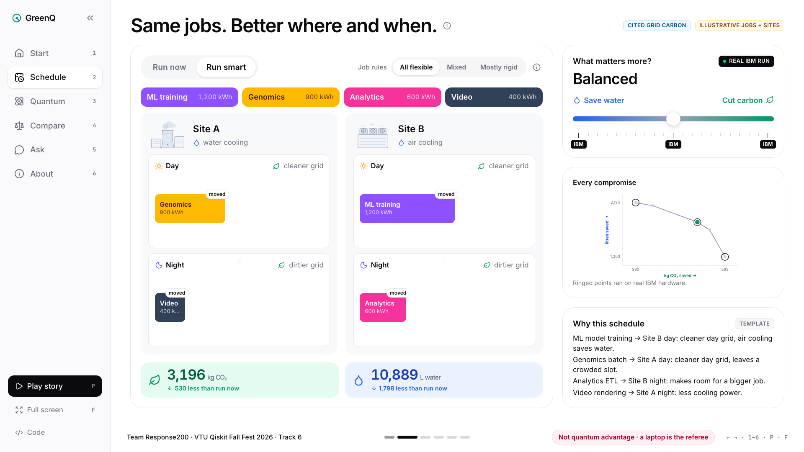
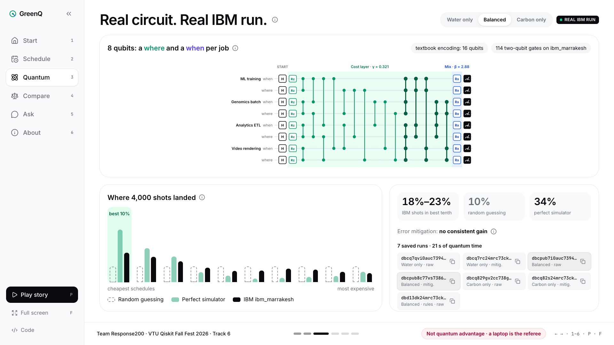
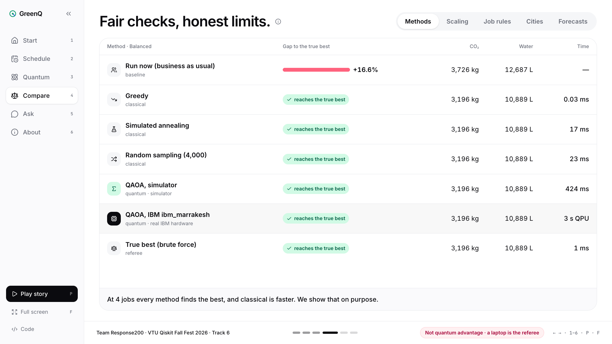
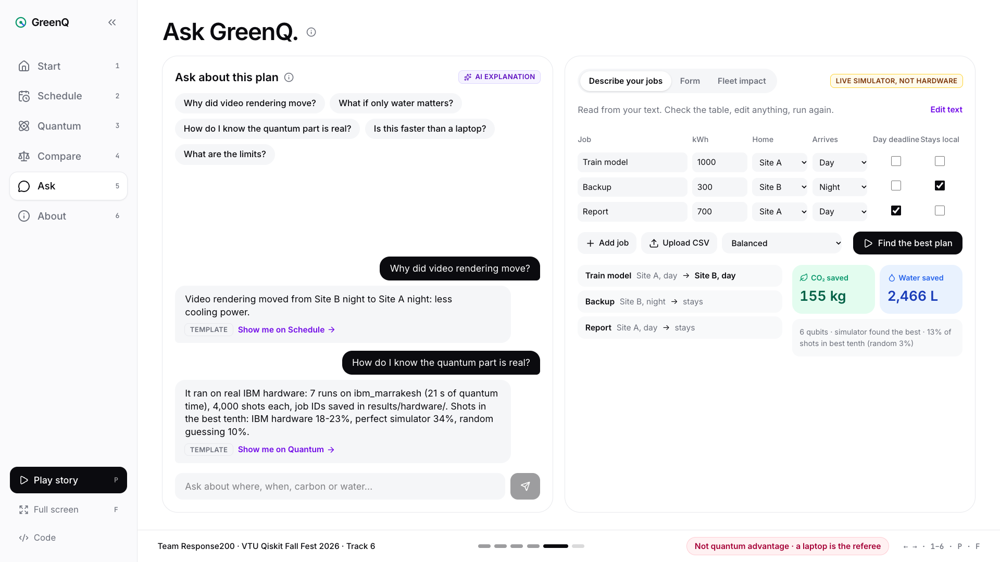
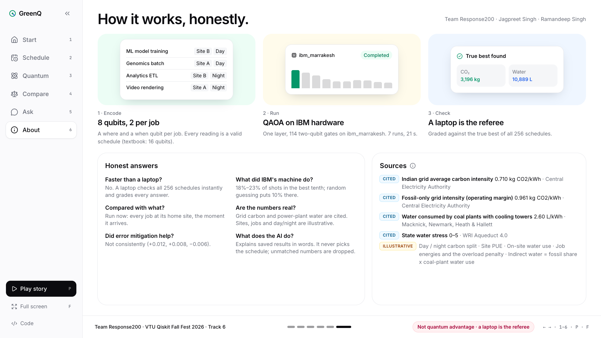
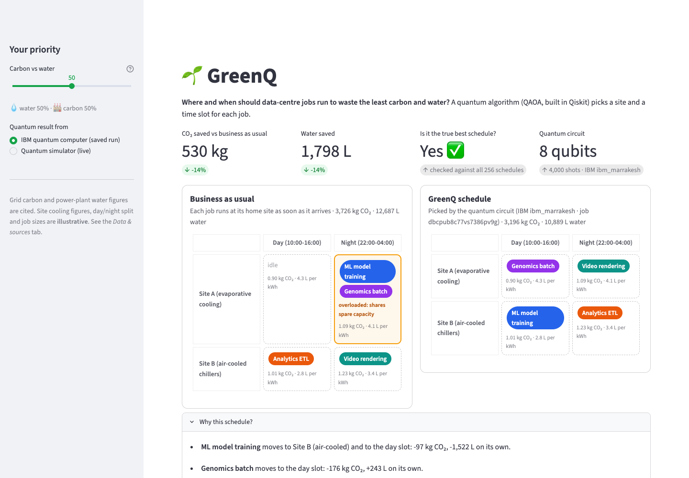
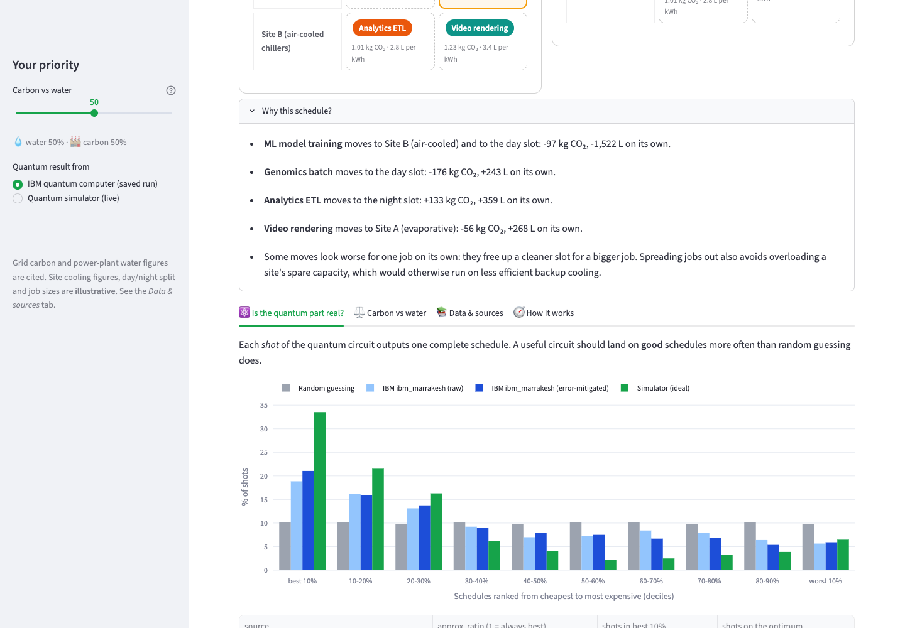
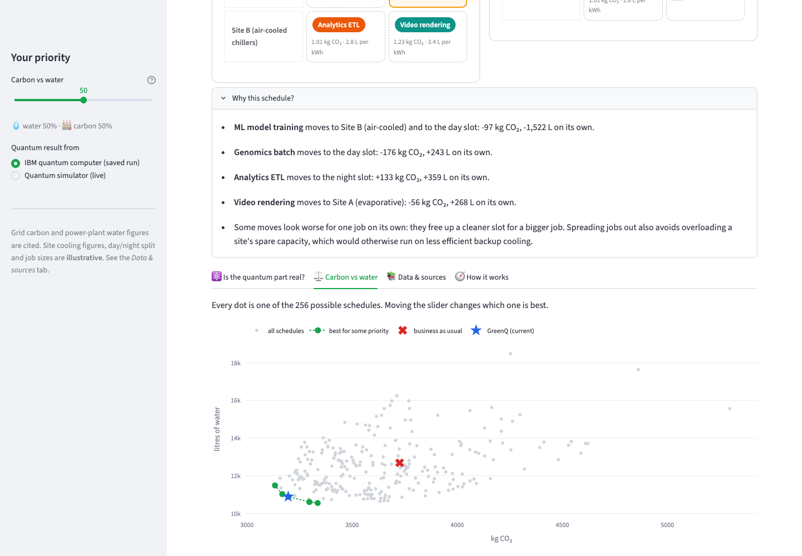

<div align="center">

# Response200

**VTU-QFF-HC-0137** &nbsp;|&nbsp; Tier: **Online** &nbsp;|&nbsp; **Track 6: Quantum Applications for Climate Change & Sustainability**

### 🌱 GreenQ: quantum scheduling of data-centre jobs for less carbon *and* less water

</div>

---

<div align="center">

| | |
| :--- | :--- |
| **Team** | Response200 |
| **Team ID** | VTU-QFF-HC-0137 |
| **Tier** | Online |
| **Track** | Track 6: Quantum Applications for Climate Change & Sustainability |
| **Repository** | [vtu-hc-response200](https://github.com/vtu-qiskit-fall-fest-2026/vtu-hc-response200.git) |
| **Organisation** | [vtu-qiskit-fall-fest-2026](https://github.com/vtu-qiskit-fall-fest-2026) |
| **Event** | VTU-QFF Hackathon — VTU-Qiskit Fall Fest 2026 |

</div>

---

## 📌 Table of Contents

- [Team Members](#-team-members-github-ids)
- [Problem Statement](#-problem-statement)
- [Proposed Solution](#-proposed-solution)
- [Approach & Architecture](#-approach--architecture)
- [Results](#-results)
- [Dewy, the guide](#-dewy-the-guide)
- [The language model's role](#-the-language-models-role)
- [Tech Stack](#-tech-stack)
- [Project Structure](#-project-structure)
- [How to Run](#-how-to-run)
- [Limitations](#-limitations-honest)
- [Credits & References](#-credits--references)
- [How to Push Code](#-how-to-push-code)
- [Submission Checklist](#-submission-checklist)
- [Resources](#-resources)
- [License](#-license)

---

## 👥 Team Members (GitHub IDs)

| # | Name | GitHub Username | Role |
| :-- | :--- | :--- | :--- |
| 1 | Jagpreet Singh | [jagpreetsingh02](https://github.com/jagpreetsingh02) | Team Lead |
| 2 | Ramandeep Singh | [Raman-2915](https://github.com/Raman-2915) | Developer |

---

## ❓ Problem Statement

**Problem:** Data centres burn electricity (carbon) and evaporate cooling water. The same flexible job (ML training, analytics, rendering) has a very different footprint depending on **which site** and **which time slot** it runs in, and the two goals conflict. Evaporative cooling saves electricity but consumes water. Air cooling saves water but uses more electricity, and in India most electricity comes from coal plants that consume water too.

**Why it matters:** India's grid averages **0.710 kg CO₂ per kWh** (CEA, FY 2024-25) and coal plants with cooling towers consume about **2.6 L of water per kWh** (NREL). Choosing *where and when* to run deferrable work is a low-cost lever on both, but the choices interact: put too many jobs on the "best" site and slot and you overload it.

**Track / Category:** Online · Track 6 · Quantum Applications for Climate Change & Sustainability

---

## 💡 Proposed Solution

**Solution:** GreenQ assigns every flexible job a (site, time slot) so the blended carbon + water footprint is as low as possible. It formulates the schedule as a cost Hamiltonian and solves it with **QAOA built in Qiskit**, on a simulator and on **real IBM Quantum hardware**. A six-screen slide demo (React + FastAPI) shows *run now* (business as usual) next to *run smart* (GreenQ), with kg CO₂ and litres of water saved, a slider that trades carbon against water (the three positions that ran on real IBM hardware are marked), the real circuit and its hardware results, fair classical comparisons, and an "Ask GreenQ" screen where a language model **explains** the saved results in plain words. The model never chooses the schedule and every number it states is checked against the data (see [The language model's role](#-the-language-models-role)).

**Key idea:** a **binary "where + when" encoding**, 2 qubits per job. Every measured bitstring is a valid schedule. It needs half the qubits of the textbook one-hot QUBO, about half the two-qubit gates on IBM hardware, and no penalty tuning.

**Why this works:** the quantum and classical sides provably solve the same problem (tests check the Hamiltonian equals the classical cost on all 256 schedules), and a brute-force baseline grades every quantum result against the true optimum. At this size a classical computer is faster: **we make no claim of quantum advantage.**



*The Start screen at 1920×1080: a wordless 16-second loop (jobs pile up at home, a quantum chip works out a plan, the jobs move, the savings count up from the data) and Dewy, our guide, in the corner. Six screens in a sidebar (Start, Schedule, Quantum, Compare, Ask, About); each fits one screen with no scrolling. Press **P** for the 50-second story, **T** for Dewy's tour, arrows or 1–6 to move, **F** for full screen.*

---

## 🧩 Approach & Architecture



1. **Input:** 4 flexible jobs × 2 sites (A = evaporative cooling, B = air-cooled chillers) × 2 slots (day, night). Grid carbon and power-plant water figures are cited; site and job figures are **illustrative** (see [greenq/data.py](greenq/data.py)).
2. **Model:** per job, CO₂ = energy × PUE × grid carbon, and water = energy × (on-site WUE + PUE × grid water). Two jobs sharing one site-slot overload its spare capacity and cost extra energy, which couples the jobs' choices. The objective is `w·CO₂/CO₂_naive + (1−w)·water/water_naive`.
3. **Quantum core:** the encoding gives 8 qubits and 256 schedules. The cost Hamiltonian is built exactly: each job's cost table is expanded on its own 2 qubits, and the "two jobs share a slot" check is `∏(1 + Z·Z)/2`. QAOA (`QAOAAnsatz`) at p = 1 is trained to minimise **CVaR** (the average cost of the best 25% of outcomes) on a simulator. The fixed circuit then runs on IBM hardware with `SamplerV2` in job mode.
4. **Post-processing:** each shot decodes to a schedule. GreenQ reports the cheapest schedule sampled, plus distribution quality: approximation ratio, share of shots in the best 10% of schedules, and P(optimal).
5. **Output:** the schedule, kg CO₂ and litres saved against business as usual, a "why this schedule" explanation, and the carbon-water trade-off frontier.

Full plain-language walkthrough: [docs/EXPLAINER.md](docs/EXPLAINER.md). Design decisions: [docs/DECISIONS.md](docs/DECISIONS.md).

---

## 📊 Results

**Scenario (illustrative):** an evening batch burst. All numbers below come from the illustrative instance in [greenq/data.py](greenq/data.py); they are not measurements of a real data centre.

**Baseline we compare against: "business as usual".** Each job runs at its home site the moment it is submitted: **3,726 kg CO₂ · 12,687 L water**. We think this is fair because:
- it is what a scheduler does when it ignores carbon and water (run immediately, where the job lives);
- it isn't a straw man: two of the four jobs already sit on the more energy-efficient site, and one already runs in the cleaner daytime slot;
- we first tried a baseline with every job in the clean daytime slot, but it made the savings look mostly like overload avoidance, so we replaced it (see [DECISIONS.md](docs/DECISIONS.md) D5).

**Best schedule (w = 0.5), verified by brute force over all 256 schedules:** **3,196 kg CO₂ (−14%) · 10,889 L water (−14%)**.

**Which run returned it, and how often?** GreenQ's answer is the cheapest schedule among the shots.
- **Ideal simulator:** returned the true best schedule; it appeared in 60 of 4,000 shots (1.5%).
- **IBM hardware, raw:** returned the true best schedule; it appeared in 33 of 4,000 shots (0.83%). It was *not* the most frequent outcome (17th most frequent).
- **IBM hardware, error-mitigated:** returned the true best schedule; 28 of 4,000 shots (0.70%), 27th most frequent.
- For comparison, random guessing would hit it about 16 times in 4,000 shots and would almost certainly see it at least once. **Finding the optimum at this size is therefore not evidence of quantum benefit.** The evidence that the circuit works is the shift of the whole distribution toward cheap schedules, shown below.

**Is the quantum part doing real work?** p = 1, 8 qubits, 4,000 shots per run. We ran **6 jobs on IBM `ibm_marrakesh`**: three priority settings (water only, balanced, carbon only), each raw and with error mitigation. The table is generated from the saved counts by `python scripts/summarize_results.py`.

*Balanced priority (w = 0.5):*

| Run | Job | Approx. ratio ↑ | Shots in best 10% ↑ | Shots on optimum | Optimum's frequency rank | Cheapest shot is optimum |
|---|---|---|---|---|---|---|
| Random guessing | | 0.743 | 10.0% | ≈16/4000 | | |
| **IBM ibm_marrakesh (raw)** | `dbcpub7i0auc73943vu0` | **0.798 ± 0.002** | **18.9%** | 33/4000 | 17 | yes |
| **IBM ibm_marrakesh (DD + twirling)** | `dbcpub8c77vs7386pv9g` | **0.805 ± 0.002** | **21.1%** | 28/4000 | 27 | yes |
| Noisy simulator (FakeMarrakesh) | | 0.831 ± 0.002 | 29.8% | 71/4000 | 1 | yes |
| Ideal simulator | | 0.843 ± 0.002 | 33.5% | 60/4000 | 11 | yes |

<details>
<summary><b>Water only (w = 0) and carbon only (w = 1)</b></summary>

*w = 0 (water only)*

| Run | Job | Approx. ratio | Shots in best 10% | Shots on optimum | Optimum's frequency rank | Cheapest shot is optimum |
|---|---|---|---|---|---|---|
| Random guessing | | 0.749 | 10.0% | ≈16/4000 | | |
| IBM ibm_marrakesh (raw) | `dbcq7qvi0auc73944pjg` | 0.801 ± 0.003 | 18.2% | 41/4000 | 8 | yes |
| IBM ibm_marrakesh (DD + twirling) | `dbcq7rc24mrc73ck6i7g` | 0.813 ± 0.002 | 18.3% | 33/4000 | 9 | yes |
| Noisy simulator (FakeMarrakesh) | | 0.847 ± 0.002 | 24.8% | 40/4000 | 21 | yes |
| Ideal simulator | | 0.858 ± 0.002 | 28.1% | 39/4000 | 24 | yes |

*w = 1 (carbon only)*

| Run | Job | Approx. ratio | Shots in best 10% | Shots on optimum | Optimum's frequency rank | Cheapest shot is optimum |
|---|---|---|---|---|---|---|
| Random guessing | | 0.762 | 10.0% | ≈16/4000 | | |
| IBM ibm_marrakesh (raw) | `dbcq829gv2cc738gq49g` | 0.825 ± 0.002 | 22.6% | 41/4000 | 11 | yes |
| IBM ibm_marrakesh (DD + twirling) | `dbcq82s24mrc73ck6is0` | 0.819 ± 0.002 | 19.1% | 40/4000 | 4 | yes |
| Noisy simulator (FakeMarrakesh) | | 0.848 ± 0.002 | 27.7% | 67/4000 | 1 | yes |
| Ideal simulator | | 0.856 ± 0.002 | 30.6% | 54/4000 | 11 | yes |

</details>

- **Every one of the 6 hardware runs beats random sampling** on the whole distribution, by 14 to 19 standard errors, and puts 18-23% of its shots in the best 10% of schedules (random: 10%).
- **Noise costs part of the ideal improvement:** the hardware keeps roughly half to two-thirds (48-67%) of the ideal simulator's gain over random.
- **Error mitigation (XY4 dynamical decoupling + gate/measurement twirling) gave no consistent benefit:** approximation ratio +0.012 (w = 0), +0.008 (w = 0.5), −0.006 (w = 1).
- Transpiled circuit on `ibm_marrakesh`: 114 two-qubit gates, depth ≈245. Each job used about 3 s of QPU time: **18 s for these six**, 21 s including the rules run below.
- The binary encoding needs **8 qubits / ~114 two-qubit gates**, against **16 qubits / ~227 gates** for a one-hot QUBO, where only 0.39% of outputs would be valid schedules.

Raw results with backend, job ID, timestamps, transpiled-circuit stats and all counts: [results/hardware/](results/hardware/). Simulator results: [results/sim/](results/sim/).

| Schedule: run now → run smart, slider, trade-off, why | Quantum: the real circuit, where 4,000 shots landed, job IDs |
|---|---|
|  |  |

| Compare: methods, scaling, job rules, cities, forecasts | Ask: grounded answers + describe your own jobs |
|---|---|
|  |  |

| About: three steps, honest answers, sources |
|---|
|  |

<details><summary>Fallback Streamlit demo screenshots</summary>

| Schedule | Quantum proof | Trade-off |
|---|---|---|
|  |  |  |

</details>

### What if jobs are not all flexible? (deadlines, data residency, priority)

Each job can carry rules (illustrative): **deadline** (must finish in the day slot), **data residency** (must stay at its home site) and **priority** (must run in the slot it was submitted to). Rules are encoded as penalty terms on each job's own qubits. Every bitstring still decodes, rule-breaking ones always cost more than any allowed schedule, and the circuit's two-qubit structure is unchanged (114 two-qubit gates).

| Preset | Allowed schedules | Balanced: CO₂ saved | Balanced: water saved |
|---|---|---|---|
| All flexible | 256 | 530 kg | 1,798 L |
| Mixed | 64 | 499 kg | 1,745 L |
| Mostly rigid | 8 | 299 kg | 1,574 L |

Savings shrink as fewer jobs are flexible (balanced priority; average over every choice of which jobs are flexible, the rest stay at home and on time):

| Share of jobs flexible | CO₂ saved | Water saved |
|---|---|---|
| 0% | 0.0% | 0.0% |
| 25% | 8.1% | 2.7% |
| 50% | 12.3% | 6.9% |
| 75% | 13.6% | 11.7% |
| 100% | 14.2% | 14.2% |

Shots that obey every rule (mixed preset, balanced): random guessing 25%, ideal simulator 99%, noisy simulator 92%, **IBM ibm_marrakesh 61%** (job `dbd13dk24mrc73cki6eg`, 3 s QPU). The cheapest rule-obeying hardware shot was the true best allowed schedule (39 of 4,000 shots).

### Is the plan fragile? (forecast error)

The plan is fixed from the forecast; then each slot's grid carbon is perturbed independently by a uniform error of up to ±5% (and ±10%), 200 seeded draws each, and the plan is compared with the brute-force best for each draw (`python scripts/run_robustness.py` → `results/robustness.json`).

| Forecast error | Priority | Within 5% of new best | Still exactly best | Worst case |
|---|---|---|---|---|
| ±5% | Water only | 100% | 92.0% | 0.37% worse |
| ±5% | Balanced | 100% | 76.5% | 0.69% worse |
| ±5% | Carbon only | 100% | 97.0% | 0.14% worse |
| ±10% | Water only | 100% | 79.0% | 2.25% worse |
| ±10% | Balanced | 100% | 63.5% | 1.84% worse |
| ±10% | Carbon only | 100% | 73.5% | 0.93% worse |

**Plain reading:** the schedule isn't fragile. Even with ±10% forecast error, it's never more than 2.3% worse than the best plan in hindsight.

### What could it be worth? (annual impact, assumptions only)

The page includes a calculator that scales the **measured** saving (14.2% CO₂, 14.2% water at balanced priority, all flexible) to a fleet you describe:

`saved per year = fleet IT energy (GWh) × 10⁶ × flexible share × footprint per kWh under business as usual (1.20 kg CO₂, 4.09 L) × measured saving`

Default inputs are **assumptions**, not data: 100 GWh/year, 20% flexible. They give about 3,420 t CO₂ and 11.6 ML of water a year. The result is only as good as those assumptions, and we make no claim about any real deployment.

### Does the location matter? Regional water stress

A litre is weighted by the **baseline water stress of the state** each site is in (WRI Aqueduct 4.0, 2023; provincial ranking, total demand; score 0–5). Power-plant water uses India's national score (4.11). The weight is score ÷ 5, an illustrative mapping. Grid carbon stays the CEA national average, because India runs one national grid, so we don't invent regional carbon figures. `python scripts/run_cities.py` → `results/cities.json`.

| City pair (Site A evaporative + Site B air-cooled) | Aqueduct 4.0 state scores (0–5) | Balanced: water saved (raw / stress-weighted) | CO₂ saved | Plan changes vs unweighted |
|---|---|---|---|---|
| Delhi NCR + Kolkata | NCT of Delhi 4.75 · West Bengal 2.53 | 2,080 L / 1,847 | 429 kg | 6 of 21 settings |
| Mumbai + Hyderabad | Maharashtra 4.20 · Telangana 3.92 | 1,798 L / 1,486 | 530 kg | 2 of 21 settings |
| Chennai + Bengaluru | Tamil Nadu 4.15 · Karnataka 3.73 | 1,798 L / 1,483 | 530 kg | 0 of 21 settings |

**Plain reading:** only Delhi NCR + Kolkata changes the plan. Delhi is extremely high stress and Kolkata medium-high, so water-heavy work moves to Kolkata: 2,080 L saved instead of 1,798, at the cost of 429 kg CO₂ saved instead of 530. Where both states are similarly stressed, the plan stays the same. QAOA on the simulator found the true best for every preset.

### How it scales (measured, simulator)

`python scripts/run_scaling.py` → `results/scaling.json`. Same 2 sites × 2 slots and balanced priority; jobs beyond the 4 demo jobs are illustrative (seeded). Only measured sizes are shown; nothing is extrapolated.

| Jobs | Qubits | Schedules | 2-qubit gates (marrakesh layout) | Best-10% share: ideal | noisy model | random | Greedy gap | Annealing gap | Exhaustive search |
|---|---|---|---|---|---|---|---|---|---|
| 4 | 8 | 256 | 114 | 33.5% | 29.5% | 10% | 0.0% | 0.00% | 0 ms |
| 5 | 10 | 1,024 | 188 | 37.9% | 30.3% | 10% | 0.1% | 0.00% | 0 ms |
| 6 | 12 | 4,096 | 280 | 35.7% | 27.7% | 10% | 1.4% | 0.00% | 0 ms |
| 7 | 14 | 16,384 | 411 | 36.5% | 25.9% | 10% | 2.1% | 0.00% | 1 ms |
| 8 | 16 | 65,536 | 518 | 37.4% | 26.6% | 10% | 2.4% | 0.15% | 3 ms |
| 9 | 18 | 262,144 | 664 | 41.9% | not run | 10% | 3.0% | 0.27% | 16 ms |
| 10 | 20 | 1,048,576 | 828 | 42.7% | not run | 10% | 3.0% | 0.13% | 94 ms |
| 11 | 22 | 4,194,304 | 1,010 | 43.6% | not run | 10% | 2.6% | 0.07% | 515 ms |

**Plain reading:**
- **Circuit size:** it grows quickly, about 9× in two-qubit gates from 8 to 22 qubits, because every pair of jobs adds gates.
- **Noise:** on the noisy model of ibm_marrakesh, QAOA keeps 83% of its ideal gain over random at 8 qubits and 60% at 16 qubits. The model is optimistic: at 8 qubits it predicted 29.5% of shots in the best tenth, and the real device gave 18.9%.
- **Classical methods:** greedy starts missing the optimum from 5 jobs (up to 3%) and annealing from 8 jobs (up to 0.3%). Exhaustive search still takes only 0.5 s at 22 qubits (4.2 million schedules). There's no quantum advantage at these sizes.

### Compared with classical methods (fair baselines)

Same objective, same instance, balanced setting (`python scripts/run_baselines.py` → `results/baselines.json`; water-only and carbon-only give the same picture):

| Method | Gap to true best | CO₂ | Water | Time |
|---|---|---|---|---|
| Business as usual | +16.6% | 3,726 kg | 12,687 L | — |
| Greedy | 0% (true best) | 3,196 kg | 10,889 L | 0.03 ms |
| Simulated annealing | 0% (true best) | 3,196 kg | 10,889 L | 17 ms |
| Random sampling (4,000) | 0% (true best) | 3,196 kg | 10,889 L | 23 ms |
| QAOA, simulator | 0% (true best) | 3,196 kg | 10,889 L | 424 ms |
| QAOA, IBM ibm_marrakesh | 0% (true best) | 3,196 kg | 10,889 L | 3 s QPU (queue not counted) |
| True best (brute force) | 0% (true best) | 3,196 kg | 10,889 L | 1 ms |

**Plain reading:** on this 4-job instance every method reaches the true best, and the classical methods are much faster. Even 4,000 random guesses find it. Gaps are measured on the blended objective. We don't claim the quantum computer wins; the claim is a correct formulation, validated end to end on real hardware, as a path to larger problems. Runtimes are medians on the demo laptop.

---

## 💧 Dewy, the guide

The demo has a small original mascot, **Dewy**: a water drop with a leaf sprout (water and carbon), eyes only. It reacts to what happens (wakes up, gets excited on Play, celebrates when the savings appear, thinks while the quantum circuit runs, dozes after 30 seconds), gives a guided tour of one widget per screen (**T**, or "Show me around"), and on the Ask screen it speaks the grounded AI answers. Its own lines are under 10 words and never contain numbers; numbers it shows come from the data. It lives in its own lane on the right edge of the screen and hops, wanders, follows your cursor with its eyes and lines up with whatever is happening, but it never stands on a widget, button or chart. **H** hides it, **Shift+H** calms it, and with reduced motion it holds still. All moods are at http://127.0.0.1:8000/#dewy-moods.

---

## 🤖 The language model's role

GreenQ uses a language model (Groq's hosted `openai/gpt-oss-20b` by default) for **words only**:

| It does | It never does |
| :--- | :--- |
| Writes the "Why this schedule" lines on the Schedule screen | Choose, change or suggest a schedule (brute force and QAOA do that) |
| Answers questions on the Ask screen in at most 3 sentences, and points to the screen that shows the answer | Produce numbers: any sentence with a number that doesn't match the saved results is removed |
| Reads a plain-English job description into the job table (then brute force + the QAOA simulator solve it, labelled *live simulator, not hardware*) | Invent a job size: a kWh figure must appear in your text, and every job passes the same validation as the form |
| Speaks through Dewy, the mascot, in one-line bubbles | Claim quantum advantage: such sentences are dropped |

How the check works ([server/llm.py](server/llm.py)): the server builds a list of named facts from `results/ui_data.json` for the current setting, sends only those facts, then splits the reply into sentences and keeps a sentence only if every number in it matches a fact (allowing ordinary rounding). The browser talks only to our FastAPI server; the API key stays in `.env` on the server and is never logged, returned or sent to the browser.

**It works with no key and no network.** The order is: live model → pre-generated `results/llm_cache.json` → fixed templates built from the same data. Each answer shows where it came from: *AI explanation* (model, live or cached) or *Template*. The audience never sees an error.

---

## 🛠️ Tech Stack

| Layer | Technology |
| :--- | :--- |
| Language | Python 3.12 |
| Quantum SDK | Qiskit 2.6 (`QAOAAnsatz`, `SparsePauliOp`, `StatevectorSampler`, preset pass managers) |
| Hardware access | qiskit-ibm-runtime 0.50 (`SamplerV2`, job mode, IBM Quantum Open Plan) |
| Simulation | Exact statevector (training), Qiskit Aer 0.18 via fake IBM backends (noise) |
| Optimisation | CVaR objective, SciPy COBYLA |
| Demo UI | React 19 + Vite 8 (TypeScript), Tailwind CSS 4 with shadcn-style tokens, Motion, Lucide icons, self-hosted Inter and JetBrains Mono |
| Demo server | FastAPI + Uvicorn (serves the built UI, `/api/data`, the live-jobs endpoint and the explanation endpoints) |
| Explanations | Groq API (OpenAI-compatible), model `openai/gpt-oss-20b` with strict JSON schema; called with `httpx`; grounded and cached (`server/llm.py`) |
| Fallback demo | Streamlit + Plotly (`app/streamlit_app.py`) |
| Tests | pytest: model, Hamiltonian, QAOA, API, LLM grounding and fallbacks, and a headless Streamlit app test |

---

## 📁 Project Structure

```text
vtu-hc-response200/
├── README.md
├── requirements.txt          # exact versions verified in a clean venv
├── pyproject.toml            # project metadata + pytest config
├── greenq/
│   ├── data.py               # sites, slots, jobs; every figure CITED or ILLUSTRATIVE
│   ├── model.py              # kg CO2 and litres for any schedule; blended objective
│   ├── encoding.py           # schedule <-> qubits; exact cost Hamiltonian
│   ├── classical.py          # brute-force optimum + naive baseline
│   ├── qaoa.py               # QAOA circuit and CVaR training
│   ├── runner.py             # Sampler runs (ideal / noisy / IBM), saves JSON
│   ├── metrics.py            # approximation ratio, best-10% share, P(optimal)
│   └── ibm.py                # IBM Quantum connection (token from .env)
├── scripts/
│   ├── run_sim.py            # train + simulate  -> results/sim/
│   ├── run_hardware.py       # run on IBM hardware -> results/hardware/
│   ├── summarize_results.py  # results tables from saved counts
│   ├── run_baselines.py      # greedy, annealing, random sampling vs QAOA -> results/baselines.json
│   ├── run_scaling.py        # 4-11 jobs (8-22 qubits) scaling study -> results/scaling.json
│   ├── run_cities.py         # water-stress city presets -> results/cities.json
│   ├── run_robustness.py     # forecast-error robustness -> results/robustness.json
│   ├── export_ui_data.py     # saved results -> results/ui_data.json for the UI
│   ├── build_llm_cache.py    # pre-generate AI explanations -> results/llm_cache.json
│   ├── ui_smoke.py           # optional browser checks (Playwright): no console errors, no overflow, numbers match data
│   ├── build_demo.py         # Full demo timeline -> docs/demo/timeline.json
│   └── build_vercel.py       # slim Vercel deploy (static app + one Python function)
├── server/                   # FastAPI: /api/data, /api/custom, serves web/dist
│   └── llm.py                # grounded explanations: facts, number check, cache, templates
├── web/                      # React + Vite demo UI (source; built into web/dist)
├── app/streamlit_app.py      # fallback demo (Streamlit)
├── results/                  # saved simulator and hardware results (JSON)
├── tests/                    # pytest suite
└── docs/                     # EXPLAINER, DECISIONS, demo timeline, screenshots
```

---

## 🚀 How to Run

### Prerequisites

- Python **3.12** (tested on 3.12.13; macOS arm64)
- [Node.js](https://nodejs.org) **20 or newer** (tested on 24.16), needed once to build the web UI
- [Git](https://git-scm.com/downloads)
- *Optional, only for new hardware runs:* an [IBM Quantum Platform](https://quantum.cloud.ibm.com/) API key

### 1. Clone and set up

```bash
git clone https://github.com/vtu-qiskit-fall-fest-2026/vtu-hc-response200.git
cd vtu-hc-response200
python3.12 -m venv .venv
source .venv/bin/activate        # Windows (PowerShell): .venv\Scripts\activate
pip install --upgrade pip
pip install -r requirements.txt
```

### 2. Run the tests

```bash
pytest -q
```

### 3. Launch the demo (one command)

```bash
python -m server
```

Then open **http://127.0.0.1:8000**. The first run builds the web UI automatically (`npm ci` + `npm run build` in `web/`, about a minute); later runs start in seconds. Use `python -m server --rebuild` after pulling new code or changing anything in `web/src`.

**Using the demo:** six screens in the left sidebar. Keys: **← →** move, **1–6** jump, **P** plays or pauses the 50-second story (all six screens, with Dewy's spotlights), **T** starts Dewy's tour (← → to step, **Esc** to stop), **D** plays the Full demo, **H** hides Dewy, **F** full screen, **Esc** leaves it. The app is laid out for a 16:9 screen and scales to fit (tested at 1920×1080 and 1366×768); the last screen is remembered.

The demo reads only saved results (`results/ui_data.json`, exported from `results/hardware/` and `results/sim/`), so it works offline and never waits for a quantum queue. The optional "Re-run this setting on the local simulator" button calls the local Qiskit simulator through the server; nothing depends on it.

**Try your own jobs (live):** on the Ask screen, "Describe your jobs" or "Form" sends up to 5 jobs to `POST /api/custom` and solves them by brute force plus the QAOA simulator (about 0.1 s). It is labelled *live simulator, not hardware* and needs the server running; everything else on the page works from saved results. CSV columns: `name, kWh, home site (A/B), arrives (day/night), day deadline (yes/no), stays local (yes/no)`.

**Fallback (no Node.js):** `streamlit run app/streamlit_app.py` starts the earlier Streamlit version of the demo.

**Frontend development:** run `python -m server` in one terminal and `cd web && npm run dev` in another (Vite proxies `/api` to the server).

**Full demo (about 3 minutes, for recording):** press **D** (or *Full demo* on the Start screen or in the sidebar). Dewy presents every feature on the real app: the virtual cursor clicks, drags the slider and types into the chat. The chat uses reviewed, saved answers, so it runs offline and is identical every time. Two presets: Standard 3:02 and Short 2:10. While it plays: **Space** pause, **← →** chapters, **R** restart, **C** captions, **Esc** stop; move the mouse for the player bar (preset, speed, chapter list).

**Live demo (Vercel):** https://greenq-xi.vercel.app (the same app; press **D** for the Full demo). To redeploy after changes: `python scripts/build_vercel.py --deploy` (needs the Vercel CLI and `vercel login`). It builds a slim folder (`deploy/vercel/greenq`, not committed): the React app as static files plus one Python function for `/api/*` that installs only FastAPI, httpx, NumPy, SciPy and Qiskit. Your `.env` is never uploaded, so the live site uses the reviewed saved answers and templates; to enable live AI answers there, add `GROQ_API_KEY` in the Vercel project's settings.

### 4. Optional: AI explanations (Groq)

Without a key everything still works, using templates. To turn on the language model, add these lines to `.env` (gitignored; get a free key at [console.groq.com](https://console.groq.com/keys)):

```text
GROQ_API_KEY=<your Groq API key>
LLM_BASE_URL=https://api.groq.com/openai/v1
LLM_MODEL=openai/gpt-oss-20b
```

Then pre-generate the answers the demo shows, so it also works offline:

```bash
python scripts/build_llm_cache.py      # several minutes (free-tier pacing); writes results/llm_cache.json with openai/gpt-oss-120b
```

Set `GREENQ_LLM_OFFLINE=1` to force the offline path (cache and templates) even with a key.

### 5. Re-run the quantum pipeline (optional)

```bash
python scripts/run_sim.py --w 0.5 --reps 1        # train + ideal and noisy simulation
python scripts/export_ui_data.py                   # refresh the data the web UI shows
```

For real hardware, create a `.env` file in the project folder (it is gitignored) containing:

```text
IBM_QUANTUM_TOKEN=<your IBM Quantum Platform API key>
```

then:

```bash
python scripts/run_hardware.py                     # least-busy device, raw + error-mitigated
python scripts/run_hardware.py --fetch <job_id>    # collect a job that was still queued
```

Each hardware job uses about 3 seconds of quantum time. The script refuses to submit if less than 60 s of your monthly allowance is left.

---

## ⚠️ Limitations (honest)

- **No quantum advantage is claimed.** 256 schedules are solved instantly by brute force, which is how we grade the quantum result. Greedy, simulated annealing and even random sampling also reach the true best at this size, and they are faster (see Results). Our claim is a correct, compact formulation, validated end to end on real hardware with measured accuracy.
- **Small instance on hardware.** Hardware runs use 4 jobs (8 qubits). The scaling study goes to 22 qubits on simulators only; one QAOA layer then needs about 1,000 two-qubit gates, beyond what current devices run reliably. The noisy device model was optimistic compared with the real chip.
- **Illustrative data.** Grid carbon (CEA) and power-plant water (NREL) are cited. Site PUE/WUE, the day/night carbon split, job sizes and the overload penalty are illustrative values chosen within published ranges, and are labelled in the code, the UI and here. Indirect water is approximated as fossil share × coal-plant water use.
- **The annual-impact figure is a what-if calculator**, built on assumed fleet size and flexible share; it is not a measurement.
- **Water stress is state-level, not city-level**, and the score → weight mapping (÷5) is our choice.
- **One grid region, two time slots.** Real deployments would use live regional carbon and weather data.
- **Training is classical.** γ and β are trained on an exact simulator, and only the trained circuit runs on hardware (Open Plan budget: 10 min per 28 days, no Session mode).
- **Job rules are illustrative** (which jobs have deadlines, residency or priority). On real hardware only 61% of shots obeyed every rule on the mixed preset (simulator 99%), because noise flips the penalised bits; GreenQ discards rule-breaking shots.
- **Error mitigation** (dynamical decoupling + twirling) gave no consistent gain on this circuit across our 3 paired runs.
- **AI explanations are wording, not analysis.** The number check catches invented numbers, not every wrong word; that's why answers are short, limited to saved facts, labelled *AI explanation*, and backed by templates. Free-typed questions need a key and network; offline only the five example questions are answered.

---

## 🙏 Credits & References

**Libraries:** [Qiskit](https://github.com/Qiskit/qiskit), [Qiskit Aer](https://github.com/Qiskit/qiskit-aer), [Qiskit IBM Runtime](https://github.com/Qiskit/qiskit-ibm-runtime), [NumPy](https://numpy.org), [SciPy](https://scipy.org), [pandas](https://pandas.pydata.org), [Matplotlib](https://matplotlib.org), [pylatexenc](https://github.com/phfaist/pylatexenc), [FastAPI](https://fastapi.tiangolo.com), [Uvicorn](https://www.uvicorn.org), [React](https://react.dev), [Vite](https://vite.dev), [Motion](https://motion.dev), [Tailwind CSS](https://tailwindcss.com), [Lucide](https://lucide.dev) icons (ISC), [Fontsource](https://fontsource.org) (Inter and JetBrains Mono, SIL Open Font License), [Streamlit](https://streamlit.io), [Plotly](https://plotly.com/python/), [python-dotenv](https://github.com/theskumar/python-dotenv), [pytest](https://pytest.org).
**Hardware:** IBM Quantum Platform (Open Plan), device `ibm_marrakesh`.
**Language model:** [Groq](https://groq.com) API (OpenAI-compatible), model [`openai/gpt-oss-20b`](https://huggingface.co/openai/gpt-oss-20b) (OpenAI open-weight model, Apache 2.0), called with [httpx](https://www.python-httpx.org).

**Data sources**
- Central Electricity Authority, Govt. of India: *CO2 Baseline Database for the Indian Power Sector*, User Guide v21.0 (Nov 2025), FY 2024-25: weighted average 0.710 tCO₂/MWh, operating margin 0.961 tCO₂/MWh.
- Macknick, Newmark, Heath & Hallett (2012), *Operational water consumption and withdrawal factors for electricity generating technologies*, Environ. Res. Lett. 7 045802 (NREL): coal with cooling tower, median 687 gal/MWh.
- Uptime Institute, *Global Data Center Survey 2024*: average PUE 1.56.
- University of Arizona, *Water-energy tradeoffs in data centers: a case study in hot-arid climates*: air-cooled site ~13% higher PUE, 66% lower source WUE.
- Equinix, *What is Water Usage Effectiveness (WUE)?*: WUE from ~0 (air-cooled) to ~2.5 L/kWh (evaporative).
- Kuzma, S., M.F.P. Bierkens, S. Lakshman, T. Luo, L. Saccoccia, E.H. Sutanudjaja and R. Van Beek (2023), *Aqueduct 4.0: Updated decision-relevant global water risk indicators*, Technical Note, World Resources Institute, [doi:10.46830/writn.23.00061](https://doi.org/10.46830/writn.23.00061). Country and provincial rankings file `Aqueduct40_rankings_download_Y2023M07D05.xlsx`, baseline water stress, CC BY 4.0. Used for state-level water-stress scores.
- The Green Grid, *WUE: a green grid data center sustainability metric* (WP #35, 2011).

**Algorithms**
- E. Farhi, J. Goldstone, S. Gutmann, *A Quantum Approximate Optimization Algorithm*, arXiv:1411.4028 (2014).
- P. Barkoutsos et al., *Improving Variational Quantum Optimization using CVaR*, Quantum 4, 256 (2020).
- L. Zhou et al., *Quantum Approximate Optimization Algorithm: Performance, Mechanism, and Implementation on Near-Term Devices*, Phys. Rev. X 10, 021067 (2020) (INTERP initialisation for p > 1).

**UI:** the v2 dashboard used the [21st.dev](https://21st.dev) community component `draggable-widget-grid` (kept unchanged in `web/src/components/ui/`); the v3 slide screens place the same GreenQ widgets in fixed layouts, because a drag grid can't fit a no-scroll slide. The page's visual style is inspired by the [Waymark template](https://waymark-template.vercel.app/); no code or assets were copied from it.

**Images and mascot:** the Start-screen animation (`web/src/components/slides/Hero.tsx`) and Dewy, the mascot (`web/src/components/mascot/`), are original SVG drawings by Team Response200 for this app, animated with Motion. No photos, stock images, AI-generated images or logos (IBM, Qiskit, VTU) are used anywhere in the app. The mascot *idea* (eyes-only face, automatic blinking and breathing, named moods, and which moment triggers which mood) was inspired by the free guide *Make Your Own Mascot* by Saksham Gupta (@saksham.700x), which walks through [Bible Strong Avatar Lab](https://github.com/smontlouis/bible-strong-avatar-lab) by Stéphane Montlouis-Calixte. We used none of its text, artwork or code, and not the AGPL-3.0 packages.

**Tools:** development was assisted by Claude Code (Anthropic); commits it co-authored are marked in the git history.

---

## 🔁 How to Push Code

> Full walkthrough: **[Git & Collaboration Handbook](../vtu-hc-guide-git-and-collaboration)**

Our team pushes small commits directly to `main` (one person drives the build), using these prefixes:

| Prefix | Meaning |
| :--- | :--- |
| `feat:` | New feature |
| `fix:` | Bug fix |
| `docs:` | Documentation only |
| `test:` | Adding or fixing tests |
| `refactor:` | Code restructure, no behaviour change |
| `chore:` | Build/config/dependency changes |

```bash
git pull origin main
git add <files>
git status              # check nothing secret (.env) is staged
git commit -m "feat: describe the change"
git push origin main
```

---

## ✅ Submission Checklist

- [x] Repository created in the organisation (team repos are private; do not change visibility)
- [ ] All team members added as **collaborators** and invitations accepted
- [x] `README.md` updated with project details, problem statement and solution
- [x] Team members listed under [Team Members](#-team-members-github-ids)
- [x] `requirements.txt` committed and project runs from a clean clone
- [x] Code pushed to `main` and the latest `main` builds successfully
- [x] At least one real IBM Quantum hardware run saved in `results/hardware/`
- [x] `README` includes demo screenshots
- [ ] Demo video uploaded to **YouTube** and linked here
- [ ] Solution **PPT** submitted on **[quc.vtu.ac.in](https://quc.vtu.ac.in)** (due Oct 23, 6:00 PM IST)
- [ ] Short project summary submitted on the hackathon portal

---

## 📚 Resources

| Resource | Link |
| :--- | :--- |
| 🔁 Git & collaboration handbook | [Git & Collaboration Handbook](../vtu-hc-guide-git-and-collaboration) |
| ❓ Problem statements, solutions & terms | [Problem Statements, Solutions & Terms](../vtu-hc-guide-problem-and-solution) |
| 📄 README writing guide | [README Guide & Template](../vtu-hc-guide-readme-template) |
| ⚛️ Qiskit documentation | https://quantum.cloud.ibm.com/docs/ |
| 🧪 Qiskit Aer simulator | https://qiskit.github.io/qiskit-aer/ |
| 💻 IBM Quantum Platform | https://quantum.cloud.ibm.com/ |
| 🎓 Qiskit learning | https://quantum.cloud.ibm.com/learning |
| 📋 GitHub Docs | https://docs.github.com/ |

---

## 📄 License

Released under the [MIT License](LICENSE). See `LICENSE` for details.

---

<div align="center">

**Response200** · Team ID `VTU-QFF-HC-0137` · Tier `Online`
· Built with ⚛️ Qiskit for the VTU-QFF Hackathon

[⬆ Back to Top](#response200)

</div>
