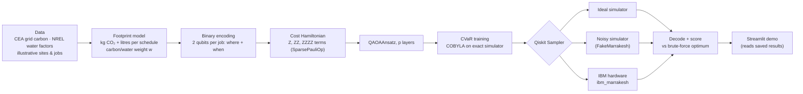

<div align="center">

# Response200

**VTU-QFF-HC-0137** &nbsp;|&nbsp; Tier: **Online** &nbsp;|&nbsp; **Track 6: Quantum Applications for Climate Change & Sustainability**

### 🌱 GreenQ: quantum scheduling of data-centre jobs for less carbon *and* less water

</div>

---

<div align="center">

| | |
| :--- | :--- |
| **Team** | Response200 |
| **Team ID** | VTU-QFF-HC-0137 |
| **Tier** | Online |
| **Track** | Track 6: Quantum Applications for Climate Change & Sustainability |
| **Repository** | [vtu-hc-response200](https://github.com/vtu-qiskit-fall-fest-2026/vtu-hc-response200.git) |
| **Organisation** | [vtu-qiskit-fall-fest-2026](https://github.com/vtu-qiskit-fall-fest-2026) |
| **Event** | VTU-QFF Hackathon — VTU-Qiskit Fall Fest 2026 |

</div>

---

## 📌 Table of Contents

- [Team Members](#-team-members-github-ids)
- [Problem Statement](#-problem-statement)
- [Proposed Solution](#-proposed-solution)
- [Approach & Architecture](#-approach--architecture)
- [Results](#-results)
- [Tech Stack](#-tech-stack)
- [Project Structure](#-project-structure)
- [How to Run](#-how-to-run)
- [Limitations](#-limitations-honest)
- [Credits & References](#-credits--references)
- [How to Push Code](#-how-to-push-code)
- [Submission Checklist](#-submission-checklist)
- [Resources](#-resources)
- [License](#-license)

---

## 👥 Team Members (GitHub IDs)

| # | Name | GitHub Username | Role |
| :-- | :--- | :--- | :--- |
| 1 | Jagpreet Singh | [jagpreetsingh02](https://github.com/jagpreetsingh02) | Team Lead |
| 2 | Ramandeep Singh | [Raman-2915](https://github.com/Raman-2915) | Developer |

---

## ❓ Problem Statement

**Problem:** Data centres burn electricity (carbon) and evaporate cooling water. The same flexible job (ML training, analytics, rendering) has a very different footprint depending on **which site** and **which time slot** it runs in, and the two goals conflict. Evaporative cooling saves electricity but consumes water. Air cooling saves water but uses more electricity, and in India most electricity comes from coal plants that consume water too.

**Why it matters:** India's grid averages **0.710 kg CO₂ per kWh** (CEA, FY 2024-25) and coal plants with cooling towers consume about **2.6 L of water per kWh** (NREL). Choosing *where and when* to run deferrable work is a low-cost lever on both, but the choices interact: put too many jobs on the "best" site and slot and you overload it.

**Track / Category:** Online · Track 6 · Quantum Applications for Climate Change & Sustainability

---

## 💡 Proposed Solution

**Solution:** GreenQ assigns every flexible job a (site, time slot) so the blended carbon + water footprint is as low as possible. It formulates the schedule as a cost Hamiltonian and solves it with **QAOA built in Qiskit**, on a simulator and on **real IBM Quantum hardware**. A Streamlit demo shows the business-as-usual schedule next to GreenQ's, with kg CO₂ and litres of water saved and a slider that trades carbon against water.

**Key idea:** a **binary "where + when" encoding**, 2 qubits per job. Every measured bitstring is a valid schedule. It needs half the qubits of the textbook one-hot QUBO, about half the two-qubit gates on IBM hardware, and no penalty tuning.

**Why this works:** the quantum and classical sides provably solve the same problem (tests check the Hamiltonian equals the classical cost on all 256 schedules), and a brute-force baseline grades every quantum result against the true optimum.


---

## 🧩 Approach & Architecture



1. **Input:** 4 flexible jobs × 2 sites (A = evaporative cooling, B = air-cooled chillers) × 2 slots (day, night). Grid carbon and power-plant water figures are cited; site and job figures are **illustrative** (see [greenq/data.py](greenq/data.py)).
2. **Model:** per job, CO₂ = energy × PUE × grid carbon, and water = energy × (on-site WUE + PUE × grid water). Two jobs sharing one site-slot overload its spare capacity and cost extra energy, which couples the jobs' choices. The objective is `w·CO₂/CO₂_naive + (1−w)·water/water_naive`.
3. **Quantum core:** the encoding gives 8 qubits and 256 schedules. The cost Hamiltonian is built exactly: each job's cost table is expanded on its own 2 qubits, and the "two jobs share a slot" check is `∏(1 + Z·Z)/2`. QAOA (`QAOAAnsatz`) at p = 1 is trained to minimise **CVaR** (the average cost of the best 25% of outcomes) on a simulator. The fixed circuit then runs on IBM hardware with `SamplerV2` in job mode.
4. **Post-processing:** each shot decodes to a schedule. GreenQ reports the cheapest schedule sampled, plus distribution quality: approximation ratio, share of shots in the best 10% of schedules, and P(optimal).
5. **Output:** the schedule, kg CO₂ and litres saved against business as usual, a "why this schedule" explanation, and the carbon-water trade-off frontier.

Full plain-language walkthrough: [docs/EXPLAINER.md](docs/EXPLAINER.md). Design decisions: [docs/DECISIONS.md](docs/DECISIONS.md).

---

## 📊 Results

**Scenario (illustrative):** an evening batch burst. Business as usual runs every job at its home site immediately: **3,726 kg CO₂ · 12,687 L water**.
**GreenQ (w = 0.5), found on IBM hardware and equal to the brute-force optimum:** **3,196 kg CO₂ (−14%) · 10,889 L water (−14%)**.

**Is the quantum part doing real work?** (p = 1, 8 qubits, 4,000 shots per run)

| Run | Approx. ratio ↑ | Shots in best 10% of schedules ↑ | Shots on the optimum |
|---|---|---|---|
| Random guessing (baseline) | 0.743 | 10.0% | 0.39% |
| **IBM `ibm_marrakesh`, raw** · job `dbcpub7i0auc73943vu0` | **0.798 ± 0.002** | **18.9%** | 0.83% |
| **IBM `ibm_marrakesh`, DD + twirling** · job `dbcpub8c77vs7386pv9g` | **0.805 ± 0.002** | **21.1%** | 0.70% |
| Noisy simulator (FakeMarrakesh) | 0.831 | 29.8% | 1.8% |
| Ideal simulator | 0.843 | 33.5% | 1.5% |

- Real hardware beats random sampling by ~15 standard errors, and both hardware runs contain the true optimum.
- Noise costs part of the ideal improvement: the hardware keeps ~55-60% of the ideal gain over random. Error mitigation (dynamical decoupling + gate/measurement twirling) helped only slightly (~2σ).
- Transpiled circuit on `ibm_marrakesh`: 114 two-qubit gates, depth 247. The two jobs used ~3 s of QPU time each.
- The binary encoding needs **8 qubits / ~114 two-qubit gates**, against **16 qubits / ~227 gates** for a one-hot QUBO, where only 0.39% of outputs would be valid schedules.

Raw results with backend, job ID, timestamps, transpiled-circuit stats and all counts: [results/hardware/](results/hardware/). Simulator results: [results/sim/](results/sim/).

| Quantum proof view | Carbon vs water trade-off |
|---|---|
|  |  |

---

## 🛠️ Tech Stack

| Layer | Technology |
| :--- | :--- |
| Language | Python 3.12 |
| Quantum SDK | Qiskit 2.6 (`QAOAAnsatz`, `SparsePauliOp`, `StatevectorSampler`, preset pass managers) |
| Hardware access | qiskit-ibm-runtime 0.50 (`SamplerV2`, job mode, IBM Quantum Open Plan) |
| Simulation | Exact statevector (training), Qiskit Aer 0.18 via fake IBM backends (noise) |
| Optimisation | CVaR objective, SciPy COBYLA |
| Demo | Streamlit, Plotly |
| Tests | pytest (includes a headless Streamlit app test) |

---

## 📁 Project Structure

```text
vtu-hc-response200/
├── README.md
├── requirements.txt          # exact versions verified in a clean venv
├── pyproject.toml            # project metadata + pytest config
├── greenq/
│   ├── data.py               # sites, slots, jobs; every figure CITED or ILLUSTRATIVE
│   ├── model.py              # kg CO2 and litres for any schedule; blended objective
│   ├── encoding.py           # schedule <-> qubits; exact cost Hamiltonian
│   ├── classical.py          # brute-force optimum + naive baseline
│   ├── qaoa.py               # QAOA circuit and CVaR training
│   ├── runner.py             # Sampler runs (ideal / noisy / IBM), saves JSON
│   ├── metrics.py            # approximation ratio, best-10% share, P(optimal)
│   └── ibm.py                # IBM Quantum connection (token from .env)
├── scripts/
│   ├── run_sim.py            # train + simulate  -> results/sim/
│   └── run_hardware.py       # run on IBM hardware -> results/hardware/
├── app/streamlit_app.py      # demo UI
├── results/                  # saved simulator and hardware results (JSON)
├── tests/                    # pytest suite
└── docs/                     # EXPLAINER, DECISIONS, PPT content, screenshots
```

---

## 🚀 How to Run

### Prerequisites

- Python **3.12** (tested on 3.12.13; macOS arm64)
- [Git](https://git-scm.com/downloads)
- *Optional, only for new hardware runs:* an [IBM Quantum Platform](https://quantum.cloud.ibm.com/) API key

### 1. Clone and set up

```bash
git clone https://github.com/vtu-qiskit-fall-fest-2026/vtu-hc-response200.git
cd vtu-hc-response200
python3.12 -m venv .venv
source .venv/bin/activate        # Windows (PowerShell): .venv\Scripts\activate
pip install --upgrade pip
pip install -r requirements.txt
```

### 2. Run the tests

```bash
pytest -q
```

### 3. Launch the demo

```bash
streamlit run app/streamlit_app.py
```

The demo reads the saved hardware results in `results/hardware/`, so it works offline and never waits for a quantum queue.

### 4. Re-run the quantum pipeline (optional)

```bash
python scripts/run_sim.py --w 0.5 --reps 1        # train + ideal and noisy simulation
```

For real hardware, create a `.env` file in the project folder (it is gitignored) containing:

```text
IBM_QUANTUM_TOKEN=<your IBM Quantum Platform API key>
```

then:

```bash
python scripts/run_hardware.py                     # least-busy device, raw + error-mitigated
python scripts/run_hardware.py --fetch <job_id>    # collect a job that was still queued
```

Each hardware job uses about 3 seconds of quantum time. The script refuses to submit if less than 60 s of your monthly allowance is left.

---

## ⚠️ Limitations (honest)

- **No quantum advantage is claimed.** 256 schedules are solved instantly by brute force, which is how we grade the quantum result. Our claim is a correct, compact formulation, validated end to end on real hardware with measured accuracy.
- **Small instance.** 4 jobs, 2 sites, 2 slots (8 qubits). Circuit depth grows with the number of job pairs, and hardware noise limits the size today.
- **Illustrative data.** Grid carbon (CEA) and power-plant water (NREL) are cited. Site PUE/WUE, the day/night carbon split, job sizes and the overload penalty are illustrative values chosen within published ranges, and are labelled in the code, the UI and here. Indirect water is approximated as fossil share × coal-plant water use.
- **One grid region, two time slots.** Real deployments would use live regional carbon and weather data.
- **Training is classical.** γ and β are trained on an exact simulator, and only the trained circuit runs on hardware (Open Plan budget: 10 min per 28 days, no Session mode).
- **Error mitigation** gave only a marginal gain on this circuit.

---

## 🙏 Credits & References

**Libraries:** [Qiskit](https://github.com/Qiskit/qiskit), [Qiskit Aer](https://github.com/Qiskit/qiskit-aer), [Qiskit IBM Runtime](https://github.com/Qiskit/qiskit-ibm-runtime), [NumPy](https://numpy.org), [SciPy](https://scipy.org), [pandas](https://pandas.pydata.org), [Matplotlib](https://matplotlib.org), [pylatexenc](https://github.com/phfaist/pylatexenc), [Streamlit](https://streamlit.io), [Plotly](https://plotly.com/python/), [python-dotenv](https://github.com/theskumar/python-dotenv), [pytest](https://pytest.org).
**Hardware:** IBM Quantum Platform (Open Plan), device `ibm_marrakesh`.

**Data sources**
- Central Electricity Authority, Govt. of India: *CO2 Baseline Database for the Indian Power Sector*, User Guide v21.0 (Nov 2025), FY 2024-25: weighted average 0.710 tCO₂/MWh, operating margin 0.961 tCO₂/MWh.
- Macknick, Newmark, Heath & Hallett (2012), *Operational water consumption and withdrawal factors for electricity generating technologies*, Environ. Res. Lett. 7 045802 (NREL): coal with cooling tower, median 687 gal/MWh.
- Uptime Institute, *Global Data Center Survey 2024*: average PUE 1.56.
- University of Arizona, *Water-energy tradeoffs in data centers: a case study in hot-arid climates*: air-cooled site ~13% higher PUE, 66% lower source WUE.
- Equinix, *What is Water Usage Effectiveness (WUE)?*: WUE from ~0 (air-cooled) to ~2.5 L/kWh (evaporative).
- The Green Grid, *WUE: a green grid data center sustainability metric* (WP #35, 2011).

**Algorithms**
- E. Farhi, J. Goldstone, S. Gutmann, *A Quantum Approximate Optimization Algorithm*, arXiv:1411.4028 (2014).
- P. Barkoutsos et al., *Improving Variational Quantum Optimization using CVaR*, Quantum 4, 256 (2020).
- L. Zhou et al., *Quantum Approximate Optimization Algorithm: Performance, Mechanism, and Implementation on Near-Term Devices*, Phys. Rev. X 10, 021067 (2020) (INTERP initialisation for p > 1).

**Tools:** development was assisted by Claude Code (Anthropic); commits it co-authored are marked in the git history.

---

## 🔁 How to Push Code

> Full walkthrough: **[Git & Collaboration Handbook](../vtu-hc-guide-git-and-collaboration)**

Our team pushes small commits directly to `main` (one person drives the build), using these prefixes:

| Prefix | Meaning |
| :--- | :--- |
| `feat:` | New feature |
| `fix:` | Bug fix |
| `docs:` | Documentation only |
| `test:` | Adding or fixing tests |
| `refactor:` | Code restructure, no behaviour change |
| `chore:` | Build/config/dependency changes |

```bash
git pull origin main
git add <files>
git status              # check nothing secret (.env) is staged
git commit -m "feat: describe the change"
git push origin main
```

---

## ✅ Submission Checklist

- [x] Repository created in the organisation (team repos are private; do not change visibility)
- [ ] All team members added as **collaborators** and invitations accepted
- [x] `README.md` updated with project details, problem statement and solution
- [x] Team members listed under [Team Members](#-team-members-github-ids)
- [x] `requirements.txt` committed and project runs from a clean clone
- [x] Code pushed to `main` and the latest `main` builds successfully
- [x] At least one real IBM Quantum hardware run saved in `results/hardware/`
- [x] `README` includes demo screenshots
- [ ] Demo video uploaded to **YouTube** and linked here
- [ ] Solution **PPT** submitted on **[quc.vtu.ac.in](https://quc.vtu.ac.in)** (due Oct 23, 6:00 PM IST)
- [ ] Short project summary submitted on the hackathon portal

---

## 📚 Resources

| Resource | Link |
| :--- | :--- |
| 🔁 Git & collaboration handbook | [Git & Collaboration Handbook](../vtu-hc-guide-git-and-collaboration) |
| ❓ Problem statements, solutions & terms | [Problem Statements, Solutions & Terms](../vtu-hc-guide-problem-and-solution) |
| 📄 README writing guide | [README Guide & Template](../vtu-hc-guide-readme-template) |
| ⚛️ Qiskit documentation | https://quantum.cloud.ibm.com/docs/ |
| 🧪 Qiskit Aer simulator | https://qiskit.github.io/qiskit-aer/ |
| 💻 IBM Quantum Platform | https://quantum.cloud.ibm.com/ |
| 🎓 Qiskit learning | https://quantum.cloud.ibm.com/learning |
| 📋 GitHub Docs | https://docs.github.com/ |

---

## 📄 License

Released under the [MIT License](LICENSE). See `LICENSE` for details.

---

<div align="center">

**Response200** · Team ID `VTU-QFF-HC-0137` · Tier `Online`
· Built with ⚛️ Qiskit for the VTU-QFF Hackathon

[⬆ Back to Top](#response200)

</div>
